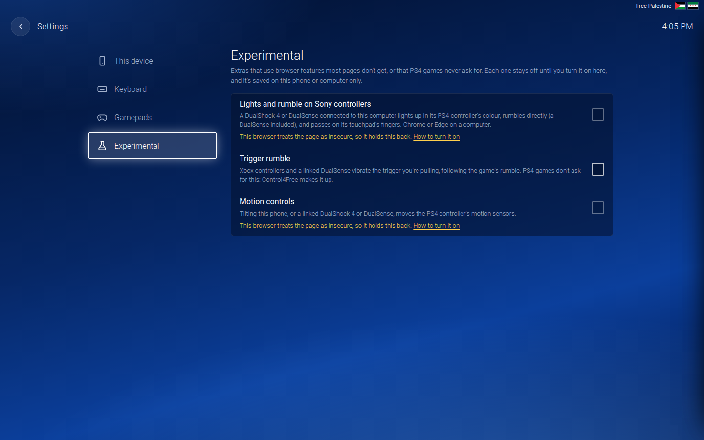
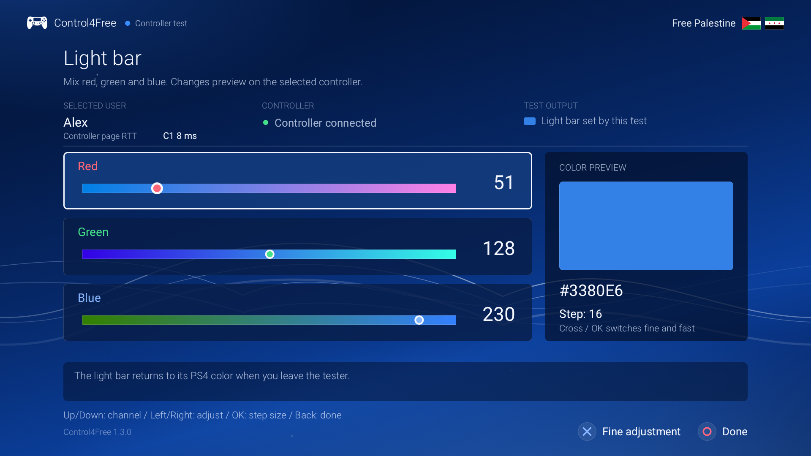

# Playing

## Connect a controller

1. Make sure Control4Free is running: the app on the PS4 says **Running** and shows the address.
2. On a phone, tablet or computer on the same network, open that address, for example
   `http://192.168.1.20:4264`, or scan the app's QR code.
3. Pick a free controller. The PS4 shows its *"Who's using this controller?"* screen.
4. Choose a user with the D-pad (**Left** and **Right**) and press **Cross**, or follow the guest option.

Connect one controller at a time, and finish the user screen before the next person picks theirs. **Don't
press PS while that screen is up**: it cancels the choice. PS works normally once you're signed in.

Signing out of that user on the PS4 disconnects their virtual controllers. The page clears the user's name,
returns to the home screen, and switches gamepads assigned to those controllers to **Off**. Pick a
controller again to reconnect. Other signed-in players keep playing.

After a brief network interruption, leave the page open: it reconnects and tries to reclaim its
controllers while the service still retains them. If they have been removed or another device owns them,
pick a free controller again. Rest mode signs users out, so it also requires a new selection.

The home screen shows all four controllers live:

| State | Meaning |
|---|---|
| **Free** | Nobody is using it. Pick it to play. |
| **Connecting** | The PS4 is setting it up. Takes a moment. |
| **Choose user on PS4** | Waiting for someone to pick a user on the PS4's screen. |
| **Connected** | Signed in and ready. The tile shows the user's name. |
| **Paused** | Its phone or PC stopped sending input, for example because the screen locked. |
| **This device** / **+1 device** | Who's driving it: this browser, or other ones. |

## Inviting someone

Press the **QR code button** at the top of the home screen, or **☰ → Invite someone** on the controller
screen. The page shows its own address as a QR code: a friend scans it with their phone's camera and gets the
controller page, as long as they're on the same network as the PS4. Tap outside the panel to close it.

## Touch controls

The controller screen is a DualShock 4 laid out for your screen, best held sideways:

- **Sticks** follow your thumb. With **Floating sticks** on, a stick starts wherever your thumb lands.
- **The touchpad** takes one or two fingers. A quick tap clicks it; hold still to keep it pressed.
- **L3 and R3**: tap a stick, then touch it again straight away to press it in. If you'd rather have separate
  buttons, turn off **Double-tap a stick for L3 / R3**.
- **PS, Share and Options** are real controller buttons, so PS takes you to the PS4's home screen.

## Your own layout

Open the menu (**☰**) and choose **Edit the button layout**. Drag a button to move it, change its size, or
hide it. **Reset to default** puts everything back; tap it twice, so a stray tap can't throw a layout away. Each device keeps its own layout, separately for portrait
and landscape.

## Keyboard

On a computer the keyboard drives the controller open on the page. To change a key, press **Keyboard keys** at
the bottom of the home screen: click a control on the picture of the controller, then press its new key (see
[Gamepad mapping](gamepad-mapping.md#the-keyboard)). Turn on **Show keyboard keys** to see them on the buttons.

| Controller | Key | Controller | Key |
|---|---|---|---|
| Cross | Space | L1 / R1 | Q / E |
| Circle | Esc | L2 / R2 | 1 / 3 |
| Square | Backspace | L3 / R3 | Z / C |
| Triangle | Enter | Options | O |
| D-pad | I J K L | Share | V |
| Left stick | W A S D | PS | P |
| Right stick | Arrow keys | Touchpad click | U |
| Touchpad corners | T Y G H | | |

## Gamepads

Connect an Xbox, DualSense, Switch Pro or other gamepad to the phone or computer and press a button on it. It
appears under **Gamepads on this device**:

- if a controller is open and has no gamepad assigned yet, the first new gamepad drives it;
- otherwise, pick the controller each gamepad plays as. One computer can run all four controllers this way;
- a row lights up while you use its gamepad, so you can tell which is which;
- several gamepads can play as the same controller, a wheel and its pedals for example;
- **Mapping** changes what its buttons and sticks do. See [Gamepad mapping](gamepad-mapping.md).

Keep the page's window in front: browsers only read gamepads for the active window.

Without a direct link, a DualShock 4 or DualSense provides its touchpad click through the browser's
gamepad input. Link it under [Experimental features](#experimental-features) to send the positions of
up to two fingers as well.

With several Xbox controllers on Chrome or Edge for Windows, check that each Xbox button appears on its
own gamepad in **Gamepad Controls**. Some browser backends combine those presses; see the
[GameInput workaround](troubleshooting.md#gamepads). This is not a general Control4Free requirement.

**"This browser only allows gamepads on secure pages."** Some browsers only offer gamepads on `https`
pages, and the console's page is plain `http`. Save the page to the device (**Save page as** on a computer),
open the saved file, and enter the console's address in its connection box. Touch and the keyboard work either
way.

After updating Control4Free, load the page from the updated service before saving it again. A saved page
keeps its old connection code until you replace it. If the browser asks for
local-network access, allow it for the controller page so it can reach your PS4.

## Settings

**☰ → All settings** has this device's settings. They stay in this browser.
**Gamepads** in the settings changes each gamepad's mapping, and **Keyboard** the keys. **Experimental** has
extras that stay off until you turn them on: see [Experimental features](#experimental-features).

| Setting | What it does |
|---|---|
| **Keep the screen on** | The phone's screen doesn't turn off while the page drives a controller. |
| **Vibration** | The phone buzzes when the game rumbles, and briefly when you press a button (Android). |
| **Floating sticks** | A stick starts wherever your thumb lands in its area. |
| **Tap the touchpad to click** | A quick tap presses the touchpad button. |
| **Double-tap a stick for L3 / R3** | Off: L3 and R3 get their own buttons. |
| **Show keyboard keys** | Labels the buttons with their keyboard keys. |

The bottom of the home screen shows the version and the round trip to the console in milliseconds. It
helps spot network delays, but it does not measure the full delay from a button press to a game's response.

## On your phone's home screen

Add the page to your home screen and it opens like an app:

- **iPhone and iPad (Safari)**: **Share → Add to Home Screen**. It opens without Safari's bars.
- **Android (Chrome)**: **⋮ → Add to Home screen**. Because the page is plain `http`, it opens in a Chrome
  tab.

The icon only works while Control4Free is running, and it remembers the PS4's address: reserve that address
for the PS4 in your router so it doesn't change.

**Full screen**: the **⛶** button in the corner. Safari on iPhone doesn't let pages go full screen, so there
it explains how to use the home screen instead.

## Rumble and light bar

When a game rumbles the controller, the device driving it feels it:

- **an Android phone** buzzes, with **Vibration** turned on in the settings. Safari on iPhone doesn't let pages
  vibrate the phone;
- **a gamepad** playing as that controller rumbles too, though not every controller supports vibration in
  the browser. When the browser knows it can't, the gamepad's row says *no rumble in this browser*.

A gamepad's own light bar stays as it is, unless you link a DualShock 4 or DualSense under
[Experimental features](#experimental-features).

The page also glows in the controller's **light-bar colour**: the player colour the PS4 gives each user, or
whatever colour the game sets. Until one is set, a controller shows its own colour (1 blue, 2 red, 3 green,
4 pink).

## Experimental features

**☰ → All settings → Experimental** has three switches. Each stays off until you turn it on, and is saved in
this browser only. With all three off, the page works exactly as it does without them.

| Switch | What it does | Where it works |
|---|---|---|
| **Lights and rumble on Sony controllers** | Link a DualShock 4 or DualSense for its light bar, direct rumble and up to two touchpad fingers. While linked, its buttons, sticks and analog triggers come directly from the controller; its **Mapping** is bypassed. | Chrome or Edge on a computer |
| **Trigger rumble** | Adds an effect to the trigger you're pulling, derived from the game's normal rumble. See [Trigger rumble](#trigger-rumble) below for setup and behavior. | Xbox controllers with browser trigger-rumble support; a linked DualSense |
| **Motion controls** | Tilting the phone, or a linked DualShock 4 or DualSense, moves the PS4 controller's motion sensors. Hold the phone sideways with the screen towards you, like a controller. **Recenter** makes the way you hold it now the resting position. | Chrome on Android; a linked controller on a computer |

For **Lights and rumble** or **Motion controls**, first follow the short
[Chrome/Edge flag setup](troubleshooting.md#experimental-features). Then turn the switch on. For a Sony
controller, press **Link**, select it in the browser's device list, and allow access. For phone motion,
allow the sensor prompt if shown and press **Recenter** while holding the phone still. A linked Sony
controller can provide motion too.

### Trigger rumble

Turn on **Trigger rumble** and assign the gamepad to the controller you are playing as. An Xbox
controller uses the browser's trigger-rumble support; it does not need the Sony **Link** button.
For a DualSense, also turn on **Lights and rumble on Sony controllers** and **Link** it.

The effect follows normal rumble from the PS4 game and the physical trigger you are pulling:

- Pull only L2 or R2 and that trigger receives the effect. With both held, the one pulled last receives
  it. Release that trigger while keeping the other pulled and the effect moves to the other one.
- With neither trigger pulled, neither receives an effect. The game must be rumbling for there to be
  anything to feel.
- Stronger game rumble produces stronger trigger vibration. A linked DualSense pulses more slowly for
  heavy rumble and faster for light rumble.
- Selection follows the gamepad's physical triggers, before any mapping. Remapping an unrelated button
  to L2 does not make that button select a trigger effect.

On a DualSense this uses a vibration effect in its adaptive triggers. Control4Free generates it from
ordinary PS4 rumble; it does not reproduce a game's authored adaptive resistance or PS5 haptics.
It changes the feedback you feel, not the analog L2/R2 pressure sent to the game. A DualShock 4 keeps
its normal rumble and has no separate trigger effect.

For a quick check, use a game that rumbles while you pull a trigger, or select the same user in the PS4
app's **Test controllers** and run **Large motor** or **Small motor** while holding a trigger.

## Testing controllers on the PS4

The app on the PS4 shows what each signed-in user's controller sends, read the way a game reads it. Press
**Options** in the app, or choose **Actions → Test controllers** with the TV remote.

- The picture lights up each button as it's pressed, moves the sticks, fills L2 and R2 as far as they're
  pulled, and shows each finger on the touchpad. The panel beside it has the numbers, motion included.
- **PS** and **Share** go to the PS4 itself, so the test doesn't show them.
- Hold **L3 + R3** for two seconds for its menu: choose another signed-in user, rumble the large or the small
  motor, choose a light-bar colour, reset it, reset the orientation, or go back. The light bar
  goes back to normal when you leave.
- The eight tools are arranged in a four-column, two-row grid. Move with the D-pad or TV remote arrows and choose with **Cross / OK**;
  **Circle / Back** returns to the live readings. Arrows wrap at the grid edges, and holding a
  controller's D-pad repeats navigation.
  Choose **Switch user** to cycle through signed-in users. Unavailable tools are dimmed and explain why
  they cannot run. Release the stick buttons that opened the menu before activating a tool.
- **Light bar** opens RGB sliders with a colour preview. **Up / Down** chooses red, green or blue;
  **Left / Right** adjusts that channel from 0 to 255 and previews it on the selected controller.
  **Cross / OK** switches between fast adjustments of 16 and precise adjustments of 1. **Circle / Back**
  returns to the tools, keeping the test colour active. **Reset light** restores the PS4's normal colour;
  leaving the tester or suspending the app also restores it.

  
- The tools view replaces the live picture while open. **Resume** returns to live buttons, sticks, touch
  and motion. Controller sampling continues independently of the screen drawing.
- A controller from the page shows up under the user signed in on it, so the test also checks the page, a
  gamepad or a keyboard from the PS4's side.
- **Controller page RTT** shows the connection round trip measured by that page, in milliseconds, in
  both the live view and tools. Controller numbers identify each virtual controller for the selected
  user. It needs the updated service and a freshly loaded or saved controller page. Missing readings
  show as measuring or unavailable; old values expire. A local physical controller has no controller-page
  connection to measure. RTT does not include the full controller, game and TV delay.

## Leaving

- **☰ → Disconnect controller** removes it from the PS4 straight away.
- **Closing the page or locking the phone** normally releases its buttons. After 3 seconds without input the
  controller goes idle, and after 15 seconds it's removed. Pick it again within those 15 seconds and you keep
  it, still signed in.
- **☰ → Stop Control4Free** stops the service and disconnects everyone. It's refused while someone else is
  still playing; the app on the PS4 can always stop it.

## Rest mode

Rest mode signs every user out, so controllers have to be picked again after the PS4 wakes up, as real ones
do. Control4Free itself carries on: reopen the page and pick your controller.
